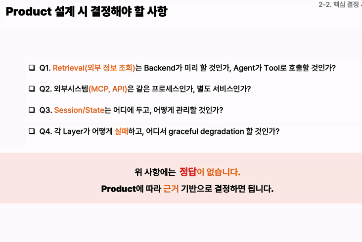

- 
- ai작업물을 내가 어떻게 설명하나? 적어도 내 눈으로 코드흐름을 파악할수 있어야됨
  - 즉, 어 이건 이런 구조 같은데 여기에 이상해보이는게 있는데 확인해볼까 느낌?

- 시스템 경계 설계
- 리트라이벌은 누가하는가
  - 백엔드가 미리 retrieval해서 에이전트에 전달하는가.
  - 아니면, agent가 tool로 retrieval을 호출하는가
- MCP server는 어디에 위치하는가
  - agent와 같은 프로세스?
  - 별도 프로세스인가? 별도 서비스인가
- Session/State는 어디에서 관리하는가
  - frontend, backend, agent, state store 중 어디가 관리의 주체인가
- 에러는 어디서 어떻게 처리하는가
  - 각 layer에서 어떻게 실패처리 하는가
  - 그때 어디서 gracful degradation을 하는가
- thread Owner 결정
  - client 또는 server중 어디서 thread_id 관리 주체가 될 것인지 결정 필요
