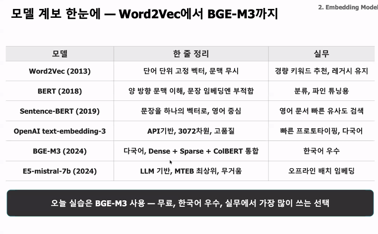
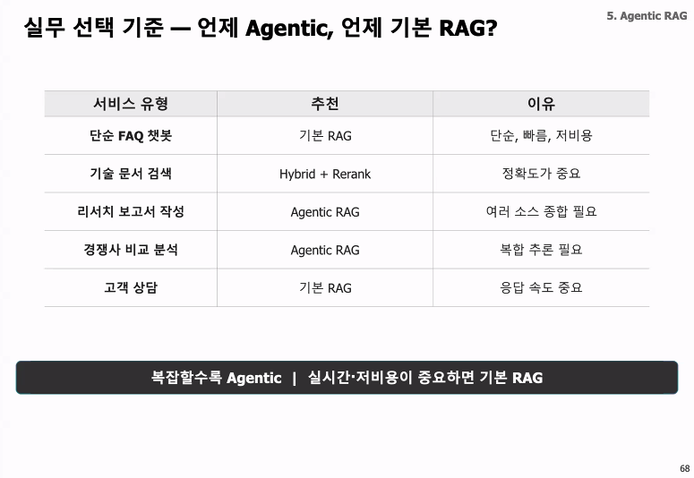

- 임베딩, 청킹, 검색 재순위화 rag 파이프라인
- faiss -> qdrant, hybreid serch, re-ranking
- 문서 로딩 - 청크+메타데이터, 임베딩, 벡터db저장, 유사도 검색, Top-k+필터, LLM 프롬프트, 최종답변

- 일하면 여러 문서들을 많이 보게될꺼다, 나만의 레그 시스템 만드는것도 좋음
- 레그는 어떤거고, 실제 이렇게 사용해봤고, 문제는 뭐였으며 어떻게 해결을 했고, 이 회사에는(도메인에서는) 어떤식으로 사용 가능할지

- 차원수 설정, 차원수 많으면 성능 좋아지나 느리고 무거워짐

- rag 파이프라인
  - 문서 임베드 검색 llm응답
- 임베딩
- 벡터 DB
- chunking : fixed chunk로 하면 빠르지만 문맥 파악 못할 가능성
- top-k

- 임베딩 모델 선택 기준
- qdrant 운영 - hnsw튜닝, 필터 검색
- 의미단위로 자르기, parent-child 전략
- dense + 키워드를 합치는 hybid search
- re-ranking 으로 순위를 한 번 더 다듬기

- 임베딩
  - 단어 단위 - 문맥 이해 - 문장 압축(rag 대중화) - llm급 만능 모델
  - 도메인별로 성격이 잘맞는 임베딩 모델 찾는 필요
  - 
  - 보통 애매하면 일단 bgm-m3, openai는 돈이듬

- 유사도(거리) - cosine similarity(방향만 봄), dot product, euclidean(L2), manhattan(L1)
- ANN(어떻게 벡터를 빠르게 찾을까)(인덱스)
  - brute Force(완전 탐색)
  - ANN(근사탐색)
    - HNSW(실무 표준)(M, ef_construction, ef_serch)
  - 속도와 정확도의 균형
- 검색 품질
  - recall@k, precision@k, MRR, nDCG@K

- chunking
  - 크게?작게? : 실부 기본값 : 300~500토큰 + 10퍼 오버랩
  - 청킹전략
    - fixed, recursive(기본권장), semantic(의미)
    - parent-child (실무 권장)
  - 메타데이터(필터로 씀)

- dense search가 실패하는 유형
  - 버전 번호, 법령번호, 에러코드, 코드/수식, 고유 명사, 새로운 정보
  - 이런 도메인일 수록 hybrid search효과 극대화
- BM25 : 희귀하고, 많이 나올수록 -> 관련성이 높다 (통계기반이라 학습 불필요)

- hybrid search
  - dense + BM25 -> RRF결합 : Dense와 BM25는 점수 스케일이 달라서 단순 합산하면 문제가 생기므로, 순위만 이용해 결합
  - 알파 가중치 : 권장(05~0.7)
  - 적합한경우
    - 검색어에 버전번호,에러코드, 모델명 이 자주 포함
    - 용어가 중요한 문서
    - 덴스만으로 성능 저조
    - 정확하지 않다는불만

- re-ranking
  - Top-50 -> Cross-encoder -> TOP-10

- agentic rag
  - ~ ~ 매출을 비교해서 증감원인을 분석해줘, 이 논문 저자의 최근 3개 논문 핵심 내용을 요약해줘, 경쟁사 ABC 의 제품 가격과 특징을 비교한 표를 만들어줘...
  - 검색 1회로는 부족한경우, 여러번 검색하고 스스로 판단해야함
  - 쿼리도 분해, 변환 재작성
  - 다양한 도구 활용
  - 오류 감지 후 재시도
  - 복잡한 질문을 다단계 처리
  - 핵심 패턴
    - query decompositon (쿼리 분해)
    - query rewriting (쿼리 재작성)
    - self-RAG (스스로 판단)
    - Multi-hop RAG (연쇄추론)
  - MCP
    - Tools(에이전트가 호출하는 함수), Resources(에이전트가 읽는 데이터), Prompts(자주 쓰는 작업 템플릿, 재사용 가능한 프롬프트 패턴 미리 정리)
  - 

- rag 구조
  - API게이트웨이 - 임베딩 - 벡터 DB - BM25 index - reRanker- LLM - cache - monitering

- rag 품질
  - RAGAS(ragas.io) : rag 전용 평가 프레임워크
    - 생성(generation) 품질
    - 검색(retrievel) 품질

- MEMO
  - 핵심은 코퍼스를 QA 데이터로 변환하고, 그 지식을 Memory Model의 파라미터 안에 학습
  - 지식을 vectorDB에 저장 대신 소형 모델(LLM파리미터)에도 들어가게 해라
  - generator Model
  - Memory Model
  - Executive Model
  - 노이즈 내성
  - 한계 : 초기 학습 비용이 매우 큼, 코퍼스 크기에 한계가 있음, 즉시 업데이트 불가

- 핵심
  - 검색품질은 청크 전략에 영향
  - 의미 검색의 맹점은 키워드 검색이 채움

# 궁금한점

- MEMO방식은 분야별 전문화를 하면 각 Memory의 전문성은 올라갈 수 있지만, 그 순간 “어느 전문가에게 물어볼 것인가”라는 문제가 생길것 같은데

- 앞으로 레그(에이전특 레그 포함)의 한계(주로 현업에서)와 발전 방향

| 현재 한계                  | 왜 현업에서 문제인가                                          | 발전 방향                                             |
| -------------------------- | ------------------------------------------------------------- | ----------------------------------------------------- |
| **Retrieval 실패**         | 정답 문서가 Top-K에 안 들어오면 좋은 LLM도 복구하기 어려움    | Hybrid, Reranker, Query Rewrite, 반복 검색            |
| **복합·다단계 질문**       | 여러 문서·시스템 정보를 연결해야 함                           | Agentic RAG, Multi-hop, Query Decomposition           |
| **Agent의 판단 오류 전파** | 첫 검색/분해가 틀리면 이후 단계도 연쇄적으로 틀릴 수 있음     | 중간 단계 검증, Self-RAG, trajectory evaluation       |
| **Latency·비용**           | Agent가 검색·LLM 호출을 반복하면 응답 시간과 비용 증가        | Adaptive RAG, 작은 모델 Router, 병렬화, 캐시          |
| **도메인/경계 문제**       | 제조+재무+법률처럼 하나의 분야로 분류하기 어려움              | Hard routing → Soft/Multi-routing, 질문 분해          |
| **데이터 최신성**          | 오래된 인덱스나 삭제된 문서가 답변에 계속 사용될 수 있음      | 자동 index refresh, freshness-aware retrieval         |
| **권한 문제**              | 검색은 됐지만 사용자가 보면 안 되는 문서일 수 있음            | ACL-aware retrieval, 사용자별 필터링                  |
| **보안**                   | 악성 문서가 Prompt Injection을 포함하거나 KB가 오염될 수 있음 | 신뢰도 검증, retrieval filtering, sandbox/tool policy |
| **평가 난이도**            | 최종 답만 맞아도 검색 경로가 잘못될 수 있음                   | 답변 + Retrieval + Agent trajectory를 따로 평가       |
| **근거 추적**              | 어떤 자료·판단으로 결론냈는지 설명하기 어려움                 | Citation, provenance, trace/audit log                 |
| **Vector Search의 한계**   | 관계·집계·정확한 조건 질의에 약함                             | Vector + BM25 + Graph + SQL/API 등 복합 검색          |
| **거대한 Knowledge Base**  | 모든 정보를 매번 검색하는 것도 비효율적                       | 계층적 Memory, domain memory, parametric memory       |

- 판단 단계가 늘어나면서 오류가 누적될 가능성도 같이 커짐
  - hallucination propagation, memory poisoning, retrieval misalignment, tool-execution 오류
- 그래서 앞으로 중요한 키워드 중 하나가 Adaptive RAG
  - 질문에 맞는 검색 전략 자체를 선택, 미래의 핵심은 “더 복잡한 RAG”보다는 필요할 때만 복잡해지는 RAG
- Vector DB가 RAG 시스템 전체였던 단계에서 → Vector DB가 여러 Retrieval Tool 중 하나가 되는 단계
  - Vector RAG에서 Graph RAG, Hybrid RAG, Multimodal RAG, Agentic RAG처럼 검색원을 다양화하는 방향
- 기업은 RAG = Vector DB”가 아닌 Enterprise Retrieval Layer 쪽으로 발전할 가능성
  | 초기 RAG 사고방식 | Enterprise Retrieval 사고방식 |
  |---|---|
  | 문서를 어떻게 찾지? | **필요한 지식을 어디서 가져오지?** |
  | Vector DB 중심 | 여러 데이터 소스 |
  | Semantic Search 중심 | Vector + BM25 + SQL + Graph + API |
  | Top-K 검색 | 검색·라우팅·권한·검증·통합 |
  | LLM에 문서 전달 | **LLM에 필요한 evidence를 구성해 전달** |
- Vector DB는 기업 지식 검색의 한 도구이고, Enterprise Retrieval Layer는 회사에 흩어진 모든 지식원을 Agent가 일관되게 검색할 수 있게 해주는 중간 계층이다.

- 평가와 관측성(Observability)이 기술적으로 굉장히 중요
  - 왜 이 query로 바꿨는가 → 어떤 문서를 검색했는가 → 왜 이 Tool을 호출했는가 → 어떤 근거를 버렸는가까지 추적
  - Agent 평가 프레임워크도 최종 응답뿐 아니라 trajectory, tool 사용, state change, authorization, recovery까지 평가 대상
- 보안도 마찬가지. RAG가 외부 데이터를 읽고 Agent가 실제 Tool까지 실행하면 Prompt Injection 잘못된 검색/판단 → 실제 행동으로 이어질 수 있음. 최근 RAG 보안 연구들은 prompt injection, knowledge poisoning, retrieval compromise, 정보 유출과 Agent의 excessive agency를 주요 위험으로 봄
- RAG의 다음 단계는 “더 잘 검색하는 시스템”에서 “질문을 이해하고, 적절한 지식원을 선택하고, 여러 번 검증하며, 권한과 비용까지 고려해 안전하게 답하거나 행동하는 지식 오케스트레이션 시스템”으로 가는 것.
- 실제 기업의 지식은 문서만 있는 게 아니라 DB, ERP/MES, API, 조직 관계, 이미지, 로그, 실시간 센서 데이터까지 흩어져 있음. 결국 좋은 기업용 Agent는 Vector Search를 잘하는 Agent보다는 **“질문에 따라 어떤 지식원을 조회해야 하는지 판단하고 그것들을 합칠 수 있는 Agent”**에 가까워질 것
